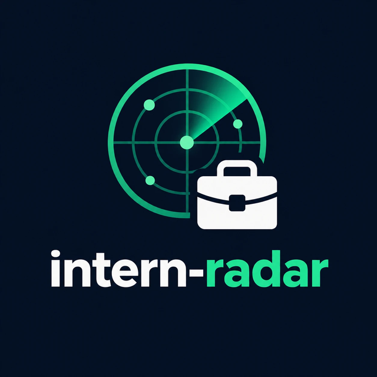
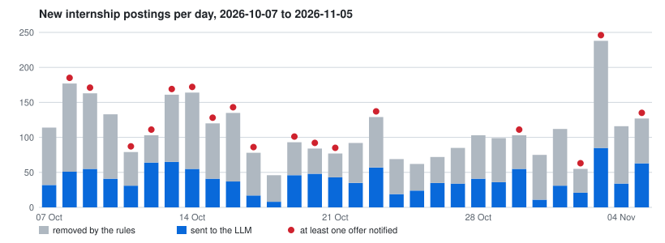
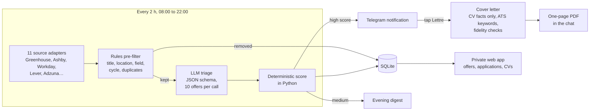

<h1 align="center">
  
</h1>

[](https://github.com/rmouahid/intern-radar/actions/workflows/tests.yml)
[](pyproject.toml)
[](LICENSE)

**intern-radar finds AI internships on company career pages as soon as they
are posted, triages them with an LLM against a candidate profile, and sends
the good ones to Telegram with a one-tap tailored cover letter.**



*Thirty days of production on a 1 vCPU VPS: every bar is one day of new
internship postings. Grey ones never reach the LLM; red dots mark days with
at least one Telegram notification. Generated by `intern-radar metrics`
from the production database ([docs/metrics.md](docs/metrics.md)).*

## How it works



1. **Collect**: one adapter per job-board API, internship titles only,
   at least 1 s between two requests to the same host; a broken posting or
   source never stops the run, and a source failing for 3 days raises an
   alert.
2. **Pre-filter**: pure rules remove what an LLM call would waste money on
   (France-only, out-of-scope fields, past cycles, aggregator copies).
3. **Triage**: a headless LLM returns internship status, AI relevance, fit
   with the internship window, eligibility and visa notes, validated against
   a JSON schema.
4. **Score**: `0.5 × company tier + 0.3 × AI relevance + 0.2 × dates`,
   computed in Python with hard exclusions, so it is reproducible and tested.
5. **Act**: notification with *Voir l'offre* and *Lettre de motivation*
   buttons; the letter is drafted from the CV only, checked for invented
   facts, and returned as a PDF.

## Results

Production database, 2026-10-07 to 2026-11-05, 30 days:

| Metric | Value |
|---|---:|
| New internship postings per day (median) | 103 |
| Removed by the rules before any LLM call | 63 % of 3,264 |
| LLM tokens per day (median, every purpose) | 113,956 |
| LLM cost per day (median, API-equivalent) | $0.15 |
| Run duration p50 / p95 | 69 s / 5 min |
| Detection to Telegram notification p50 | 3 min |

Coverage: 119 companies in `config/companies.yaml`, 85 of them with a
public feed read by one of the 11 adapters.

Reproduce from your own database:

```bash
poetry run intern-radar metrics --out docs/metrics.md --chart docs/metrics.svg
```

The full per-day table, run time per step and LLM usage per purpose are in
[docs/metrics.md](docs/metrics.md).

## Technical choices and limits

**Choices**

- **Rules before the LLM.** Two thirds of the postings are rejected by
  regular expressions and location rules for free; the LLM only sees what
  rules cannot decide.
- **The LLM judges, Python scores.** The model returns structured facts
  (dates fit, eligibility, AI relevance), never the final score; the
  weighting is a pure function with unit tests, so changing a weight is a
  `rescore`, not a new round of prompts.
- **Company career APIs, not job boards.** Greenhouse, Ashby or Workday
  publish postings first and in full; aggregators (Adzuna, Simplify) only
  fill the gaps, and their copies of an ATS posting are dropped.
- **SQLite, systemd and the standard library.** One file, one 1 vCPU / 2 GB
  VPS, no framework for the web app: the whole system fits a student's
  budget and runs unattended.
- **Telegram as the interface.** No inbound port on the server (long
  polling), notifications on the phone, and the letter arrives where the
  offer was read.

**Limits**

- 34 watched companies (Google, Meta, Apple, Mistral…) publish no usable
  feed and are only seen through aggregators, with a delay and often
  without a description.
- The LLM triage is a filter, not a verdict: scoring the same offers twice
  does not always give the same categorical answers, and many postings do
  not state their dates. Its precision and recall have not been measured
  against hand labels yet.
- Single user, single Telegram chat; letters are generated one at a time.
- The triage uses the `claude` CLI and its subscription quota, shared with
  interactive use.

Details and the measured failure modes: [docs/pipeline.md §6](docs/pipeline.md#6-limits-and-known-gaps).

## Quickstart

Requirements: Docker, a Telegram bot token
([@BotFather](https://t.me/BotFather)), and either a logged-in `claude` CLI
in `./.llm-auth` or `LLM_API_KEY` in `.env`.

```bash
git clone https://github.com/rmouahid/intern-radar.git && cd intern-radar
cp config/profile.example.yaml config/profile.yaml   # Telegram token, chat id, candidate
docker compose up -d                                 # scheduler, Telegram listener, web app
```

`poetry run intern-radar run --dry-run` runs one full pass and prints the
notifications instead of sending them. Every setting is described in
[docs/configuration.md](docs/configuration.md); systemd units are in
`deploy/`.

## Documentation

| Document | Content |
|---|---|
| [docs/architecture.md](docs/architecture.md) | components, design decisions and their trade-offs |
| [docs/pipeline.md](docs/pipeline.md) | stage-by-stage reference, failure modes, limits, operations |
| [docs/metrics.md](docs/metrics.md) | operating metrics from the production database |
| [docs/configuration.md](docs/configuration.md) | every profile and company setting |
| [docs/development.md](docs/development.md) | setup, tests, conventions, adding a source |

## Author

**Rayân Mouahid**, computer engineering student at CY Tech, working on RAG,
LLM agents and data engineering.
[GitHub](https://github.com/rmouahid) ·
[LinkedIn](https://www.linkedin.com/in/rmouahid)

## License

[MIT](LICENSE)
